# nktrois

*[English](README.md) · Français*

Doctorant en science des matériaux. Je fabrique aussi des choses : pièces imprimées, électronique, outils pour mon NAS, astro.

  <picture>
    <source media="(prefers-color-scheme: dark)" srcset="./assets/boo-dark.svg">
    <source media="(prefers-color-scheme: light)" srcset="./assets/boo-light.svg">
    
  </picture>

## Open hardware

Pièces imprimables en 3D pour l'atelier et le laboratoire, avec les STL et les sources CAO modifiables.

- [cad-parts](https://github.com/nktrois/cad-parts) — pièces mécaniques, accessoires d'atelier et outils de laboratoire

## Outils scientifiques et accessoires de laboratoire

Outils pour la science des matériaux : analyse d'images et de données, et accessoires de laboratoire imprimables en 3D.

Pour les portoirs, supports, récipients et pièces de filtration à imprimer, voir [cad-parts](https://github.com/nktrois/cad-parts).

*Les outils Python d'analyse sont en préparation.*

## Homelab & Local AI

Briques génériques tirées de mon NAS et de mes Raspberry Pi, sans dépendre de mon installation.

*En préparation.*

## Astro

Outils et accessoires pour l'astrophotographie.

- [muon-ciel-profond](https://github.com/nktrois/muon-ciel-profond) — simulateur de cadrage ciel profond : le champ de ton capteur sur une vraie carte du ciel · [ouvrir l'appli](https://nktrois.github.io/muon-ciel-profond/)
- [muon-planetaire](https://github.com/nktrois/muon-planetaire) — simulateur d’imagerie planétaire : taille sur capteur, tirage de Barlow et échantillonnage · [ouvrir l'appli](https://nktrois.github.io/muon-planetaire/)

## Experimental & Creative

Projets plus personnels : objets connectés, jeux, arcade.

- [crystal-boot](https://github.com/nktrois/crystal-boot) — animations de démarrage en cristal ASCII, en GIF, vidéo ou fichier ESP32 · [ouvrir l'appli](https://nktrois.github.io/crystal-boot/)
- [gluon](https://github.com/nktrois/gluon) — réveil-compagnon ESP32 avec yeux animés et boîtier imprimé en 3D
