# nktrois

*English · [Français](README.fr.md)*

PhD student in materials science. I also build things: 3D-printed parts, electronics, tools for my home server, astronomy gear.

  <picture>
    <source media="(prefers-color-scheme: dark)" srcset="./assets/boo-dark.svg">
    <source media="(prefers-color-scheme: light)" srcset="./assets/boo-light.svg">
    
  </picture>

## Open hardware

Printable mechanical parts and enclosures, with their OpenSCAD sources.

- [cad-parts](https://github.com/nktrois/cad-parts) — small parts designed for a specific need

## Scientific Python Tools

Image and data analysis tools for materials science.

*Coming soon.*

## Homelab & Local AI

Generic building blocks from my NAS and Raspberry Pis, independent of my own setup.

*Coming soon.*

## Astro

Tools and accessories for astrophotography.

- [muon-ciel-profond](https://github.com/nktrois/muon-ciel-profond) — deep-sky framing simulator: your sensor's field on a real sky map · [open the app](https://nktrois.github.io/muon-ciel-profond/)
- [muon-planetaire](https://github.com/nktrois/muon-planetaire) — planetary imaging simulator: target size on sensor, Barlow spacing and sampling · [open the app](https://nktrois.github.io/muon-planetaire/)

## Experimental & Creative

More personal projects: connected objects, games, arcade.

- [crystal-boot](https://github.com/nktrois/crystal-boot) — ASCII crystal boot animations, exported as GIF, video or ESP32 file · [open the app](https://nktrois.github.io/crystal-boot/)
- [gluon](https://github.com/nktrois/gluon) — ESP32 desk companion and alarm clock with animated eyes and a 3D-printed case
